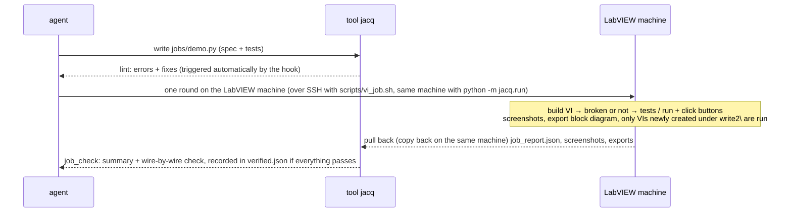

# Jacquard

**An AI agent that writes and reads LabVIEW VIs.**

English | [简体中文](README.zh-CN.md)

[](LICENSE)


Let an AI agent write runnable LabVIEW VIs from a description in Chinese, or read existing VIs into an outline people can understand.

The name comes from the Jacquard loom, which wove patterns from punched cards: here the spec plays the punched card, the wires are the threads, and the VI is the woven pattern. The command-line tools live in the `jacq` package (`python -m jacq.<tool>`).

## Overview

LabVIEW is a graphical language; programs are stored in binary `.vi` files, which can't be read and written as text the way Python can, and therefore natural-language programming through an agent isn't possible.

This repository is based on [shlim-t/labview-mcp](https://github.com/shlim-t/labview-mcp) and [pylabview](https://github.com/mefistotelis/pylabview), each with the necessary patches applied (see `writer/UPSTREAM.md`), and adds lint, catalog, checking and other features, so that an agent can break down requirements from natural language and describe a VI's front panel and block diagram with a Python dict (hereafter the spec), then first run a specification check (lint), and once it passes build the `.vi` in the LabVIEW environment with VI Scripting, then automatically run tests, take screenshots, export the `.vi` and check its wires against the spec, finally delivering the `.vi` file directly; it can also take apart and explain a `.vi` program via pylabview and LabVIEW's scan dump feature, organizing it into a text outline that explains the `.vi` program.

It can help beginners get familiar with VIs faster and lowers the barrier to writing VIs.

## Modules

The project's functionality roughly falls into two parts: building VIs, running VIs and exporting need the LabVIEW software; writing specs, checking and verifying the `vi` rely on the Python standard library and can work without the LabVIEW environment. The two parts can run on one computer with LabVIEW installed, or on two separate machines, e.g. this repository and the agent on one computer and LabVIEW running on another, the two computers connected via SSH. The diagram below and the rest of this document take the two-machine case as the example; on a single machine, drop the SSH step:




Term| Meaning |
|---  |---|
| `spec` | A Python dict describing which functional modules a VI has and how they're wired: `controLs` (input controls), `indicators` (indicators), `functions` (function nodes), `subvis` (subVIs), `structures` (loops, case and event structures), `wires` (wires) |
| `job` |A ` jobs/<name>.py` file. It contains: one or more specs (the VIS list, subVIs first), a reference implementation in Python, and for each VI the test inputs with the expected values computed by the reference implementation. A job represents what one round of work has to deliver  |
| `lint` | A static check of the spec run locally, no LabVIEW needed. It checks terminal names, whether the types at both ends of wires match, dimension changes from For loop auto-indexing, whether required inputs are left unwired, whether While loops have a stop condition, etc. Errors are divided into E (critical errors), W (warnings), I (info), and each comes with a fix hint |
| `on the LabVIEW machine` | Moving the job to a computer with LabVIEW installed and performing in turn: build VI → check for broken → run tests → run → screenshots → export block diagram → send results back → compare wires with the spec. Any failing step stops it, and the error is written into job_report.json |


| Directory | Purpose |
|---|---|
| `jacq/` | Local tools for writing specs. `lint` (static spec check), `typecheck` (checks wire and terminal types), `catalog` (queries the mapping of functions and terminal names), `wire_diff` (checks the wires of the spec and the actual VI one by one), `job_check` (summarizes the results of one LabVIEW machine round), `run` (the entry point when the code repository and LabVIEW are on the same computer), `oracle` (compares local lint with the actual VI errors, used to maintain lint) |
| `writer/` | On the LabVIEW machine, writes specs into VI programs; from [shlim-t/labview-mcp](https://github.com/shlim-t/labview-mcp), with patches for LabVIEW 2024 Q1 |
| `jobs/` | Holds `job` files |
| `catalog/` | Stores the lists of LabVIEW functions and terminal names, and the whitelist of functions verified not to error on the LabVIEW machine  |
| `lab/` | Python scripts run on the LabVIEW machine, calling `writer/` to write specs into VI programs |
| `scripts/` | Shell scripts that operate the LabVIEW machine over SSH, not needed in the same-machine case |
| `readers/` | Parses VIs. Offline, pylabview parses them and organizes a text outline including dependencies, default values, front-panel controls, block-diagram structure, constant values, primitive names, but no wiring. With access to the LabVIEW machine, wiring can be obtained via scan dump|
| `hooks/` | Automatically runs lint after the agent changes `jobs/*.py`, returning errors to the agent |
| `skills/` |`labview-vi-explain` (explain existing VIs, compare diffs), `labview-vi-write` (write VIs to requirements), `labview-data-mapping` (read a VI and the data files it produces, check what each data column means), `labview-lab-session` (requirements and steps for operating LabVIEW, covering both the same-machine and SSH ways), `labview-repo-maintain` (maintain lint, the writer, the catalog, skills) |
| `docs/` | spec quick reference, pitfalls and lint error codes, design notes, on-site checklists |
| `tests/` | Fully offline pytest |

## How the agent builds a VI

Taking "write a program: input a set of sample values, split them into blocks by block length, compute each block's mean, and raise an alarm when it exceeds the upper/lower limits" as the example

### 1. Read the constraints, learn the workflow

The agent first reads `AGENTS.md` (or is guided by the skill `labview-vi-write`) to learn the workflow and constraints

### 2. Break down the requirements, take the template

Split the requirements into several VIs: `stats` (mean/max/min/standard deviation), `limit_check` (check upper/lower limits), `moving_avg` (moving average), and the main VI `monitor`. Then take `jobs/_template.py` as the template and write ` jobs/monitor.py`, referring to the set of verified examples in `jobs/gallery.py`, e.g. For loop auto-indexing following `w02_array_io`.
> Known limitation: currently the spec only supports four structures, for_loop, while_loop, case and event; the examples cover these four, as well as other common data types and function combinations. Other common LabVIEW structures have no corresponding type in the spec, and gen.py reports unknown type directly when it meets them. To be extended gradually in future maintenance

### 3. Look up function and terminal names

The terminal names of LabVIEW functions must match those in LabVIEW exactly; a wrong one makes the build fail or a wire get lost. The agent queries the catalog:

```bash
python -m jacq.catalog terms "Greater?"
python -m jacq.catalog search array
```

### 4. Write the spec and tests

```python
SPEC_SUB = {
    "controls":   [{"name": "x", "type": "i32"}],
    "indicators": [{"name": "y", "type": "i32"}],
    "functions":  [{"name": "a", "function": "Increment"}],
    "wires":      [["x", "a.x"], ["a.x+1", "y"]],
}
```

The expected values of the tests are computed by a Python reference implementation in the same file:

```python
def ref_sub(x):
    return x + 1

VIS = [{"name": "sub", "spec": SPEC_SUB,
        "tests": [{"inputs": {"x": x}, "expect": {"y": ref_sub(x)}} for x in (0, 41, -5)]}]
```

### 5. lint

Every time the agent saves a job file, the hook automatically runs `jacq.lint --offline`. If an error (E) is reported, going to the LabVIEW machine isn't allowed. Each error comes with a fix, e.g. wiring the boolean output of a comparison function to a numeric indicator:

```
E [TYPE] gt.x > y? → o: type mismatch -- source bool, indicator o is dbl (bool → dbl)
      Fix: A boolean can't be used directly as a number: use Select (a constant on each of true/false) or Boolean To (0,1), or change the indicator to bool
```

What lint checks includes terminal names, dimension changes caused by auto-indexing, types, required inputs, case values, and common LabVIEW mistakes like "a stop button wired outside the loop is only read once". The full list is in [docs/pitfalls.md](docs/pitfalls.md).
> More checked errors will be added in future maintenance

### 6. On the LabVIEW machine

Once authorized by the user, the agent can operate LabVIEW. One round is a single command, over SSH or on the same machine:

```bash
scripts/vi_job.sh monitor                   # over SSH
python -m jacq.run monitor                   # on the same machine
```

This one command does in turn: local lint → sync writer changes (over SSH only) → construct VIs in dependency order → check for broken → run tests → for those with `runs`, run them and read the indicators → screenshots of front panel and block diagram → export images → send back locally → check wires against the spec one by one. Any failing step stops it, and the report records the failing step and the error message.

### 7. Recording

VIs that pass everything are recorded in `jobs/verified.json` together with the spec hash. If the spec is changed again afterwards, verification on the LabVIEW machine has to be run again.

### 8. Delivery

The VI path, what the subVIs do, tests results, wire check results, screenshots.

## Usage

### Requirements

Toolchain (writing specs, lint, catalog lookups, reading VI outlines, running tests):

- Python 3.10 or later, standard library only; running the tests needs `pytest`
- Reading existing `.vi` files (`readers/outline_vi.py`) needs a clone of [pylabview](https://github.com/mefistotelis/pylabview) with `readers/offline/third_party/pylabview-x64-vicd.diff` applied, placed next to the repository (`../pylabview`) or pointed to with the environment variable `PYLV`.

The Windows computer that operates LabVIEW:

- Windows, LabVIEW 2024 Q1 64-bit; enable ActiveX in Tools ▸ Options ▸ VI Server (the writer calls LabVIEW via COM)
- Python 3.13 + `pywin32`
- Writer: on the same machine, point the environment variable `LVAGENT_SHLIM` to the repository's `writer/`; over SSH, put it in `\agent_sandbox\shlim_pkg\` (the location of `agent_sandbox`, or other folder names, are set by the user. `scripts/sync_writer.sh` fills in the `.py` files)
- VIs are all built in `write2\` under `LVAGENT_BASE` (default `\agent_sandbox\lv_agentic\`); the paths in the environment variables must be under `LVAGENT_SANDBOX`

> Other LabVIEW versions are untested, and some features may differ slightly; with minor adaptation this repository will run

There are two ways for the agent to reach the LabVIEW machine:

- **Remote**: the agent is on another computer that can run Python, and can SSH to the LabVIEW machine
- **Same machine**: the agent runs directly on the LabVIEW machine, and `python -m jacq.run <job>` does lint → build/test/run → copy results to `private\lab_corpus\` → check in one command

Most features work without operating LabVIEW: writing specs, lint, catalog lookups, reading VI outlines and running tests only need Python.

### Configuration

When operating the LabVIEW machine over SSH, write the host name and the Python path on the LabVIEW machine in `private/lab.env`; on the same machine this file isn't needed, set environment variables instead (see the skill `labview-lab-session`).

```bash
cd jacquard
mkdir -p private
cat > private/lab.env <<'EOF'
LAB_HOST=lab-windows
LAB_PY='C:\Users\<LAB_USER>\AppData\Local\Programs\Python\Python313\python.exe'
EOF
python -m pytest            # fully offline, about 1 second
```

To use it in Claude Code, copy the five directories under `skills/` to `.claude/skills/` of the workspace, and register `hooks/jacq_hook.py` in `.claude/settings.json` (both PostToolUse and PreToolUse hooked on `Write|Edit`).

### Common commands

```bash
python -m jacq.catalog terms "Add"           # full set of a function's terminals and how trustworthy they are
python -m jacq.catalog search queue          # find functions by name
python -m jacq.lint myjob --offline          # when LabVIEW can't be operated: unverified names downgraded to warnings, queued into the probe queue
python -m jacq.lint myjob                    # when LabVIEW can be operated: strict mode
scripts/probe_terms.sh --queue              # on-site (over SSH): probe all names accumulated offline for verification at once
scripts/vi_job.sh myjob                     # on-site (over SSH): one round of build / test / run / screenshot / check
scripts/vi_job.sh myjob --force             # rebuild everything, whether or not the spec changed
python -m jacq.run myjob                     # same-machine mode (the agent is on the LabVIEW machine): the same round, one command
python -m jacq.job_check --status myjob      # whether each VI of this job currently counts as verified, and what the evidence is
python -m jacq.oracle myjob                  # compare lint's predictions with on-site outcomes
```

### Example:

```bash
cp jobs/_template.py jobs/demo.py           # replace <job> in the file with demo
python -m jacq.lint demo --offline
scripts/vi_job.sh demo                       # or on the same machine: python -m jacq.run demo
```

The output (excerpt) of `vi_job.sh` on the LabVIEW machine for a job made of four VIs (the top-level `monitor` calling `stats`, `limit_check`, `moving_avg`):

```
stats create True exec_state idle
stats tests 5/5 cases passed
limit_check tests 10/10 cases passed
moving_avg tests 7/7 cases passed
monitor tests 5/5 cases passed
JOB COMPLETE OK
job monitor_demo: passed; rebuilt this round ['limit_check', 'monitor', 'moving_avg', 'stats']
  monitor: create=True state=idle tests=5/5 cases passed
    wires spec 32 / VI 32, mismatches 0, non-unique drivers 0
==== verified on-site, recorded in verified.json (the screenshots still need a human look at the front-panel layout)
==== elapsed 29 s
```

More forms are in the files under `jobs/`:

| job | What it demonstrates |
|---|---|
| `gallery.py` | 12 small VIs, one per structure: shift registers, For auto-indexing, clusters, enum state machine, queues, error-cluster case, event structure + UI operation tests |
| `mcpi.py` | SubVI layering, Waveform Graph |
| `failtest.py` | Deliberately wrong VIs, used to demonstrate the error-report path |
| `typeprobe.py` | A build-only, no-run type probe batch (`BUILD_ONLY = True`), finding on-site sources for lint rules |

### Parsing an existing VI

Run locally offline:

```bash
python readers/outline_vi.py <program directory or a.vi> --print     # extraction (pylabview -x, read-only) + outline
```

The outline lists the dependent subVIs, default values, front-panel controls, the block-diagram structure indented by nesting, as well as constant values and primitive names. Chinese labels are converted back via code page 936. Outlines are written under `private/offline/outlines/` by default. Extraction uses pylabview with the x64 patch applied (see Requirements).

The outline can't parse the wiring in a VI. When wires need checking, export once read-only on the LabVIEW machine (`lab/lab_dump_corpus.py`):

```bash
python readers/vi_trace.py <dump.json> back <node id>       # where this value comes from
python readers/vi_diff.py <old dump.json> <new dump.json>    # what changed between two versions
```

Only extract with `-x`, don't repack VIs with pylabview: its Chinese encoding/decoding is lossy and will corrupt the VI.

## Rules

The following are enforced by code; lint or the LabVIEW-side scripts refuse directly:

- Only VIs the agent newly created under `write2\` are run; other VIs are only exported, not run
- The subVIs a job can call are a whitelist; hardware I/O, network, external code, dynamic-call functions on the list and VI Server class nodes can't go into a job. lint reports `HW-IO`, and `vi_job.py` on the LabVIEW side scans again before starting work and refuses the whole job. The function part is a denylist scanned by name, not exhaustive
- Only when "the report really was produced by the current job, and every VI's wires were checked" is it recorded in `jobs/verified.json`
- `catalog/terminals_confirmed.json` and `jobs/verified.json` can only be filled in by tools
- Terminal names can only come from LabVIEW itself. For unverified names, lint reports an error directly in strict mode (when LabVIEW can be operated), and offline downgrades them to warnings and queues them into the probe queue

A few more rely on people keeping them: no analog output/digital output writes; before LabVIEW is operated the user must agree in the current conversation; on the same machine, don't touch LabVIEW instances and VIs the user already has open; the user's VIs and acquired data go only in `private/`, never shared outside.

The repo currently doesn't let the agent read a real DAQ card on its own, because DAQmx access can't be opened up for reading only.

## Known limitations

- SubVI control labels can only be ASCII. LabVIEW's XML scripting parser stores labels as UTF-8, but Chinese Windows uses code page 936, and non-ASCII subVI terminal names make the caller's wires get silently dropped, so the writer reports an error directly for such labels. Top-level VIs may use Chinese labels: the writer first builds with English names and renames at the end.
- Shift registers can't pass through event structures. For buttons changing state use front-panel controls plus property nodes inside the frames.
- Boolean button text and LED colors can't be set.
- lint passing only means "very likely to build"; whether the program logic is right depends on the on-site tests.
- Swapped wiring between two nodes of the same function can't be seen by the wire check.

## Documentation

| What you need to know | Where |
|---|---|
| spec keys, structures, events, how to write state machines | [docs/spec_reference.md](docs/spec_reference.md) |
| What each lint error code means and how to fix it | [docs/pitfalls.md](docs/pitfalls.md) |
| How far lint can predict, how to calibrate with on-site results | [docs/lint_robustness.md](docs/lint_robustness.md) |
| Why it's designed this way | [docs/harness_design.md](docs/harness_design.md) |
| To verify and to extend | [docs/lab_pending.md](docs/lab_pending.md) |
| Writer patches and upstream | [writer/UPSTREAM.md](writer/UPSTREAM.md) |
| The overall map for agents | [AGENTS.md](AGENTS.md) |

## Contributing

```bash
python -m pytest                # run before committing
scripts/regen_patch.sh          # regenerate the patches after changing writer/labview_mcp/{gen,lv}.py
```

When you hit a new pitfall, if it can be written as a check, add it to `jacq/lint.py`, and at the same time add a case to `tests/test_lint_pitfalls.py` and a row to `docs/pitfalls.md`. lint errors (E) are only given where there's on-site evidence that it goes wrong, the rest give warnings (W). Where the evidence comes from and how to calibrate with `jacq.oracle`: see [docs/lint_robustness.md](docs/lint_robustness.md).

## Acknowledgements and license

- [shlim-t/labview-mcp](https://github.com/shlim-t/labview-mcp) (MIT): the original implementation of the writer
- [mefistotelis/pylabview](https://github.com/mefistotelis/pylabview) (MIT): reading VIs offline; this repository only carries the patch, not pylabview itself

This project is licensed under MIT, see [LICENSE](LICENSE); third-party components are in [NOTICE.md](NOTICE.md). LabVIEW is a trademark of NI; this project is not affiliated with NI and doesn't distribute any NI files.
