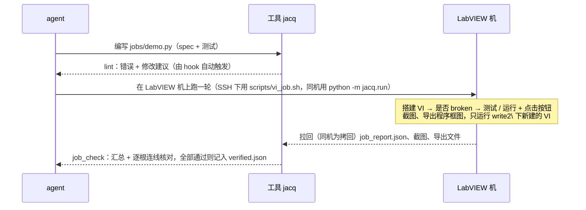

# Jacquard

**一个会写、也会读 LabVIEW VI 的 AI agent。**

[English](README.md) | 简体中文

[](LICENSE)


让 AI agent 根据中文描述写出可运行的 LabVIEW VI，或把已有的 VI 读成人能看懂的提纲。

名字取自雅卡尔提花织机（Jacquard loom），它靠打孔卡织出图案：在这里，spec 相当于打孔卡，连线是丝线，VI 是织出来的图案。命令行工具在 `jacq` 包里（`python -m jacq.<工具>`）。

## 概述

LabVIEW 是图形化语言，程序存放在二进制的 `.vi` 文件中，无法像 Python 那样以文本形式读写，因此也就无法通过 agent 进行自然语言编程。

本仓库基于 [shlim-t/labview-mcp](https://github.com/shlim-t/labview-mcp) 和 [pylabview](https://github.com/mefistotelis/pylabview)，分别打上了必要的补丁（见 `writer/UPSTREAM.md`），并增加了 lint、catalog、核对等功能，使 agent 能够从自然语言拆解需求，用 Python dict（下称 spec）描述 VI 的前面板和程序框图，先做规范检查（lint），通过后在 LabVIEW 环境中用 VI Scripting 搭建 `.vi`，随后自动运行测试、截图、导出 `.vi` 并把连线与 spec 逐一核对，最后直接交付 `.vi` 文件；它也可以借助 pylabview 和 LabVIEW 的 scan dump 功能拆解并讲解 `.vi` 程序，整理成解释该 `.vi` 程序的文本提纲。

它可以帮助初学者更快熟悉 VI，降低编写 VI 的门槛。

## 模块

项目的功能大致分为两部分：搭建 VI、运行 VI 和导出需要 LabVIEW 软件；编写 spec、检查和核对 `vi` 依赖 Python 标准库，不需要 LabVIEW 环境也能工作。两部分可以在一台装有 LabVIEW 的电脑上运行，也可以分在两台机器上，例如本仓库和 agent 在一台电脑上，LabVIEW 运行在另一台上，两台电脑通过 SSH 连接。下图及本文其余部分以两台机器的情形为例；单机时去掉 SSH 这一步即可：




术语| 含义 |
|---  |---|
| `spec` | 一个 Python dict，描述 VI 有哪些功能模块、它们如何连线：`controls`（输入控件）、`indicators`（显示控件）、`functions`（函数节点）、`subvis`（子 VI）、`structures`（循环、条件和事件结构）、`wires`（连线） |
| `job` |一个 ` jobs/<name>.py` 文件。它包含：一个或多个 spec（VIS 列表，子 VI 在前）、一个 Python 参考实现，以及每个 VI 的测试输入和由参考实现算出的期望值。一个 job 代表一轮工作要交付的内容  |
| `lint` | 在本地对 spec 做的静态检查，不需要 LabVIEW。它检查端子名、连线两端类型是否匹配、For 循环自动索引带来的维度变化、必需输入是否未接、While 循环是否有停止条件等。错误分为 E（严重错误）、W（警告）、I（提示），每条都附带修改提示 |
| `在 LabVIEW 机上` | 把 job 放到装有 LabVIEW 的电脑上，依次执行：搭建 VI → 检查是否 broken → 运行测试 → 运行 → 截图 → 导出程序框图 → 送回结果 → 将连线与 spec 比对。任何一步失败即停止，并把错误写入 job_report.json |


| 目录 | 用途 |
|---|---|
| `jacq/` | 编写 spec 用的本地工具。`lint`（spec 静态检查）、`typecheck`（检查连线和端子类型）、`catalog`（查询函数与端子名的对应）、`wire_diff`（逐一核对 spec 与实际 VI 的连线）、`job_check`（汇总一轮 LabVIEW 机的结果）、`run`（代码仓库和 LabVIEW 在同一台电脑上时的入口）、`oracle`（将本地 lint 与实际 VI 报错对比，用于维护 lint） |
| `writer/` | 在 LabVIEW 机上把 spec 写成 VI 程序；来自 [shlim-t/labview-mcp](https://github.com/shlim-t/labview-mcp)，带有针对 LabVIEW 2024 Q1 的补丁 |
| `jobs/` | 存放 `job` 文件 |
| `catalog/` | 存放 LabVIEW 函数和端子名的列表，以及经 LabVIEW 机验证不会报错的函数白名单  |
| `lab/` | 在 LabVIEW 机上运行的 Python 脚本，调用 `writer/` 把 spec 写成 VI 程序 |
| `scripts/` | 通过 SSH 操作 LabVIEW 机的 shell 脚本，同机情形下不需要 |
| `readers/` | 解析 VI。离线时由 pylabview 解析，整理出包含依赖、默认值、前面板控件、程序框图结构、常量值、原语名称的文本提纲，但没有连线。能访问 LabVIEW 机时，可通过 scan dump 获得连线|
| `hooks/` | agent 修改 `jobs/*.py` 后自动运行 lint，把错误返回给 agent |
| `skills/` |`labview-vi-explain`（讲解已有 VI、比较差异）、`labview-vi-write`（按需求写 VI）、`labview-data-mapping`（读 VI 及其产生的数据文件，核对每列数据的含义）、`labview-lab-session`（操作 LabVIEW 的要求和步骤，涵盖同机和 SSH 两种方式）、`labview-repo-maintain`（维护 lint、writer、catalog、skill） |
| `docs/` | spec 速查、踩坑记录与 lint 错误码、设计说明、现场检查清单 |
| `tests/` | 完全离线的 pytest |

## agent 如何搭建一个 VI

以"写一个程序：输入一组采样值，按块长分块，计算每块的均值，超出上下限时报警"为例

### 1. 读约束，了解流程

agent 先读 `AGENTS.md`（或由 skill `labview-vi-write` 引导），了解工作流程和约束

### 2. 拆解需求，套用模板

把需求拆成几个 VI：`stats`（均值/最大/最小/标准差）、`limit_check`（检查上下限）、`moving_avg`（滑动平均），以及主 VI `monitor`。然后以 `jobs/_template.py` 为模板编写 ` jobs/monitor.py`，参考 `jobs/gallery.py` 中已验证的示例集，例如 For 循环自动索引参照 `w02_array_io`。
> 已知限制：目前 spec 只支持 for_loop、while_loop、case 和 event 四种结构；示例覆盖了这四种结构以及其他常见的数据类型和函数组合。LabVIEW 其他常见结构在 spec 中没有对应类型，gen.py 遇到时会直接报 unknown type。将在后续维护中逐步扩展

### 3. 查函数名和端子名

LabVIEW 函数的端子名必须与 LabVIEW 中的完全一致；写错一个就会导致搭建失败或连线丢失。agent 查询 catalog：

```bash
python -m jacq.catalog terms "Greater?"
python -m jacq.catalog search array
```

### 4. 编写 spec 和测试

```python
SPEC_SUB = {
    "controls":   [{"name": "x", "type": "i32"}],
    "indicators": [{"name": "y", "type": "i32"}],
    "functions":  [{"name": "a", "function": "Increment"}],
    "wires":      [["x", "a.x"], ["a.x+1", "y"]],
}
```

测试的期望值由同一文件中的 Python 参考实现计算：

```python
def ref_sub(x):
    return x + 1

VIS = [{"name": "sub", "spec": SPEC_SUB,
        "tests": [{"inputs": {"x": x}, "expect": {"y": ref_sub(x)}} for x in (0, 41, -5)]}]
```

### 5. lint

agent 每次保存 job 文件，hook 都会自动运行 `jacq.lint --offline`。只要报出错误（E），就不允许去 LabVIEW 机。每条错误都附带修改方法，例如把比较函数的布尔输出连到数值显示控件：

```
E [TYPE] gt.x > y? → o: type mismatch -- source bool, indicator o is dbl (bool → dbl)
      Fix: A boolean can't be used directly as a number: use Select (a constant on each of true/false) or Boolean To (0,1), or change the indicator to bool
```

lint 检查的内容包括端子名、自动索引引起的维度变化、类型、必需输入、条件值，以及"接在循环外的停止按钮只会被读一次"这类常见 LabVIEW 错误。完整列表见 [docs/pitfalls.md](docs/pitfalls.md)。
> 后续维护中会加入更多可检查的错误

### 6. 在 LabVIEW 机上

经用户授权后，agent 可以操作 LabVIEW。一轮只需一条命令，SSH 和同机均可：

```bash
scripts/vi_job.sh monitor                   # 通过 SSH
python -m jacq.run monitor                   # 在同一台机器上
```

这一条命令依次执行：本地 lint → 同步 writer 的改动（仅 SSH 下）→ 按依赖顺序构建 VI → 检查是否 broken → 运行测试 → 对带 `runs` 的 VI 运行并读取显示控件 → 截取前面板和程序框图 → 导出图片 → 送回本地 → 逐一将连线与 spec 核对。任何一步失败即停止，报告中记录失败的步骤和错误信息。

### 7. 记录

全部通过的 VI 连同 spec 哈希一起记入 `jobs/verified.json`。之后如果再改动 spec，就必须重新在 LabVIEW 机上验证。

### 8. 交付

VI 路径、各子 VI 的作用、测试结果、连线核对结果、截图。

## 使用

### 环境要求

工具链（编写 spec、lint、查 catalog、读 VI 提纲、运行测试）：

- Python 3.10 及以上，仅用标准库；运行测试需要 `pytest`
- 读取已有 `.vi` 文件（`readers/outline_vi.py`）需要一份打上 `readers/offline/third_party/pylabview-x64-vicd.diff` 的 [pylabview](https://github.com/mefistotelis/pylabview) 克隆，放在仓库旁边（`../pylabview`），或用环境变量 `PYLV` 指定。

操作 LabVIEW 的 Windows 电脑：

- Windows，LabVIEW 2024 Q1 64-bit；在 工具 ▸ 选项 ▸ VI 服务器 中启用 ActiveX（writer 通过 COM 调用 LabVIEW）
- Python 3.13 + `pywin32`
- Writer：同机时把环境变量 `LVAGENT_SHLIM` 指向仓库的 `writer/`；SSH 下放在 `\agent_sandbox\shlim_pkg\`（`agent_sandbox` 的位置或其他文件夹名由用户决定，`scripts/sync_writer.sh` 负责填入 `.py` 文件）
- VI 全部建在 `LVAGENT_BASE`（默认 `\agent_sandbox\lv_agentic\`）下的 `write2\` 中；环境变量中的路径必须位于 `LVAGENT_SANDBOX` 之下

> 其他 LabVIEW 版本未经测试，部分功能可能略有差异；稍加适配后本仓库即可运行

agent 连接 LabVIEW 机有两种方式：

- **远程**：agent 在另一台能运行 Python 的电脑上，能通过 SSH 连到 LabVIEW 机
- **同机**：agent 直接运行在 LabVIEW 机上，`python -m jacq.run <job>` 一条命令完成 lint → 搭建/测试/运行 → 把结果拷到 `private\lab_corpus\` → 核对

大部分功能不需要操作 LabVIEW：编写 spec、lint、查 catalog、读 VI 提纲和运行测试只需要 Python。

### 配置

通过 SSH 操作 LabVIEW 机时，把主机名和 LabVIEW 机上的 Python 路径写入 `private/lab.env`；同机时不需要这个文件，改为设置环境变量（见 skill `labview-lab-session`）。

```bash
cd jacquard
mkdir -p private
cat > private/lab.env <<'EOF'
LAB_HOST=lab-windows
LAB_PY='C:\Users\<LAB_USER>\AppData\Local\Programs\Python\Python313\python.exe'
EOF
python -m pytest            # 完全离线，约 1 秒
```

在 Claude Code 中使用时，把 `skills/` 下的五个目录拷到工作区的 `.claude/skills/`，并在 `.claude/settings.json` 中注册 `hooks/jacq_hook.py`（PostToolUse 和 PreToolUse 都挂在 `Write|Edit` 上）。

### 常用命令

```bash
python -m jacq.catalog terms "Add"           # 某个函数的全部端子及其可信程度
python -m jacq.catalog search queue          # 按名称查找函数
python -m jacq.lint myjob --offline          # 无法操作 LabVIEW 时：未核实的名字降为警告，并排入探针队列
python -m jacq.lint myjob                    # 可以操作 LabVIEW 时：严格模式
scripts/probe_terms.sh --queue              # 现场（通过 SSH）：一次性探测离线积累的所有待核实名字
scripts/vi_job.sh myjob                     # 现场（通过 SSH）：一轮 搭建 / 测试 / 运行 / 截图 / 核对
scripts/vi_job.sh myjob --force             # 不管 spec 是否改动，全部重建
python -m jacq.run myjob                     # 同机模式（agent 在 LabVIEW 机上）：同样的一轮，一条命令
python -m jacq.job_check --status myjob      # 这个 job 的每个 VI 目前是否算已验证，证据是什么
python -m jacq.oracle myjob                  # 将 lint 的预测与现场结果对比
```

### 示例：

```bash
cp jobs/_template.py jobs/demo.py           # 把文件中的 <job> 替换为 demo
python -m jacq.lint demo --offline
scripts/vi_job.sh demo                       # 或在同一台机器上：python -m jacq.run demo
```

一个由四个 VI 组成的 job（顶层 `monitor` 调用 `stats`、`limit_check`、`moving_avg`）在 LabVIEW 机上运行 `vi_job.sh` 的输出（节选）：

```
stats create True exec_state idle
stats tests 5/5 cases passed
limit_check tests 10/10 cases passed
moving_avg tests 7/7 cases passed
monitor tests 5/5 cases passed
JOB COMPLETE OK
job monitor_demo: passed; rebuilt this round ['limit_check', 'monitor', 'moving_avg', 'stats']
  monitor: create=True state=idle tests=5/5 cases passed
    wires spec 32 / VI 32, mismatches 0, non-unique drivers 0
==== verified on-site, recorded in verified.json (the screenshots still need a human look at the front-panel layout)
==== elapsed 29 s
```

更多写法见 `jobs/` 下的文件：

| job | 演示内容 |
|---|---|
| `gallery.py` | 12 个小 VI，每种结构一个：移位寄存器、For 自动索引、簇、枚举状态机、队列、错误簇条件结构、事件结构 + UI 操作测试 |
| `mcpi.py` | 子 VI 分层、波形图 |
| `failtest.py` | 故意写错的 VI，用于演示报错路径 |
| `typeprobe.py` | 只搭建不运行的类型探针批次（`BUILD_ONLY = True`），为 lint 规则寻找现场依据 |

### 解析已有 VI

在本地离线运行：

```bash
python readers/outline_vi.py <程序目录或 a.vi> --print     # 提取（pylabview -x，只读）+ 提纲
```

提纲列出所依赖的子 VI、默认值、前面板控件、按嵌套缩进的程序框图结构，以及常量值和原语名称。中文标签通过代码页 936 转回。提纲默认写在 `private/offline/outlines/` 下。提取使用打过 x64 补丁的 pylabview（见环境要求）。

提纲无法解析 VI 中的连线。需要核对连线时，在 LabVIEW 机上只读导出一次（`lab/lab_dump_corpus.py`）：

```bash
python readers/vi_trace.py <dump.json> back <节点 id>       # 这个值从哪里来
python readers/vi_diff.py <旧 dump.json> <新 dump.json>    # 两个版本之间改了什么
```

只用 `-x` 提取，不要用 pylabview 重新打包 VI：它的中文编解码是有损的，会损坏 VI。

## 规则

以下由代码强制执行；lint 或 LabVIEW 端脚本会直接拒绝：

- 只运行 agent 在 `write2\` 下新建的 VI；其他 VI 只导出，不运行
- job 可调用的子 VI 是白名单；名单上的硬件 I/O、网络、外部代码、动态调用函数以及 VI 服务器类节点不能进入 job。lint 报 `HW-IO`，LabVIEW 端的 `vi_job.py` 在开工前会再扫描一次并拒绝整个 job。函数部分是按名称扫描的黑名单，并不完备
- 只有"报告确实由当前 job 产生，并且每个 VI 的连线都核对过"，才会记入 `jobs/verified.json`
- `catalog/terminals_confirmed.json` 和 `jobs/verified.json` 只能由工具填写
- 端子名只能来自 LabVIEW 本身。对未核实的名字，lint 在严格模式下（可以操作 LabVIEW 时）直接报错，离线时降为警告并排入探针队列

还有几条要靠人来遵守：不写模拟输出/数字输出；操作 LabVIEW 之前，用户必须在当前对话中同意；同机时，不要碰用户已经打开的 LabVIEW 实例和 VI；用户的 VI 和采集的数据只放在 `private/`，绝不外传。

本仓库目前不允许 agent 自行读取真实的 DAQ 卡，因为 DAQmx 的访问无法限定为只读。

## 已知限制

- 子 VI 的控件标签只能是 ASCII。LabVIEW 的 XML scripting 解析器把标签存为 UTF-8，但中文 Windows 使用代码页 936，非 ASCII 的子 VI 端子名会让调用方的连线被悄悄丢掉，因此 writer 遇到这类标签会直接报错。顶层 VI 可以使用中文标签：writer 先用英文名搭建，最后再改名。
- 移位寄存器无法穿过事件结构。按钮切换状态请使用前面板控件加帧内的属性节点。
- 无法设置布尔按钮的文字和 LED 的颜色。
- lint 通过只代表"很可能能搭建"；程序逻辑是否正确取决于现场测试。
- 同一函数的两个节点之间接反的连线，连线核对看不出来。

## 文档

| 想了解的内容 | 位置 |
|---|---|
| spec 的键、结构、事件、状态机写法 | [docs/spec_reference.md](docs/spec_reference.md) |
| 每个 lint 错误码的含义和修改方法 | [docs/pitfalls.md](docs/pitfalls.md) |
| lint 能预测到什么程度，如何用现场结果校准 | [docs/lint_robustness.md](docs/lint_robustness.md) |
| 为什么这样设计 | [docs/harness_design.md](docs/harness_design.md) |
| 待验证与待扩展 | [docs/lab_pending.md](docs/lab_pending.md) |
| writer 补丁与上游 | [writer/UPSTREAM.md](writer/UPSTREAM.md) |
| 给 agent 的总地图 | [AGENTS.md](AGENTS.md) |

## 参与贡献

```bash
python -m pytest                # 提交前运行
scripts/regen_patch.sh          # 修改 writer/labview_mcp/{gen,lv}.py 后重新生成补丁
```

遇到新的坑时，如果能写成检查，就加到 `jacq/lint.py`，同时在 `tests/test_lint_pitfalls.py` 中加一个用例、在 `docs/pitfalls.md` 中加一行。lint 错误（E）只在有现场证据表明会出错的地方给出，其余给警告（W）。证据从何而来、如何用 `jacq.oracle` 校准：见 [docs/lint_robustness.md](docs/lint_robustness.md)。

## 致谢与许可

- [shlim-t/labview-mcp](https://github.com/shlim-t/labview-mcp)（MIT）：writer 的原始实现
- [mefistotelis/pylabview](https://github.com/mefistotelis/pylabview)（MIT）：离线读取 VI；本仓库只携带补丁，不包含 pylabview 本身

本项目采用 MIT 许可，见 [LICENSE](LICENSE)；第三方组件见 [NOTICE.md](NOTICE.md)。LabVIEW 是 NI 的商标；本项目与 NI 无关，也不分发任何 NI 文件。
